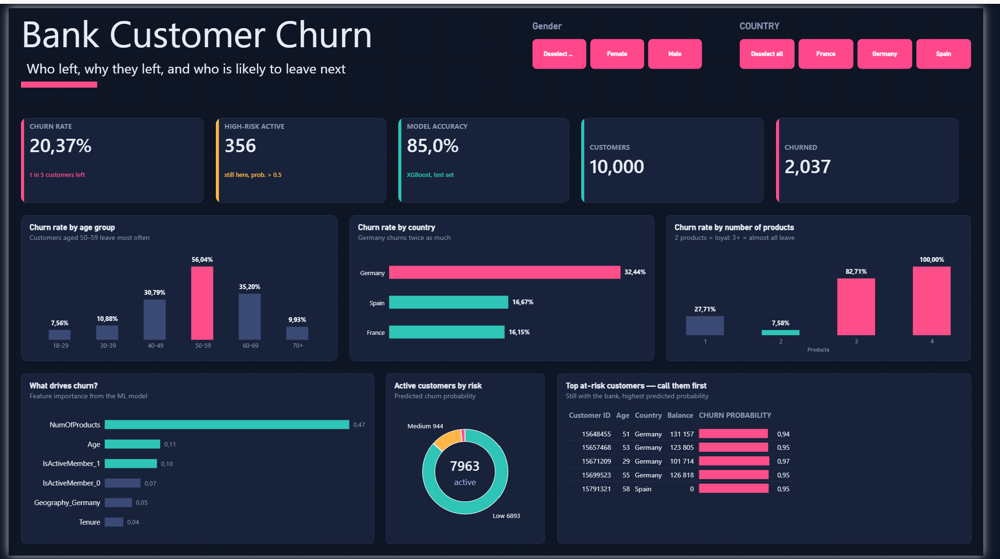

# Bank Customer Churn Prediction & Dashboard

Independent project for my university **Power BI course**. An XGBoost model predicts which bank customers are likely to leave, and a Power BI dashboard shows who left, why, and who is at risk next.

## Key insights

- **20.4%** of 10,000 customers left (1 in 5).
- **Germany** churns twice as much as France and Spain.
- Customers aged **50–59** churn the most (56%).
- **Number of products** is the strongest driver of churn.
- **356 active customers** are high risk (probability > 0.5).

## Tools

Python (Pandas, Scikit-learn, XGBoost, SMOTE) · Power BI · DAX

## Files

| File | Description |
|---|---|
| `Dashboard.pbix` | Power BI dashboard |
| `ml_part.ipynb` | Data preparation and XGBoost model (85% test accuracy) |
| `dashboard.png` | Dashboard screenshot | 
